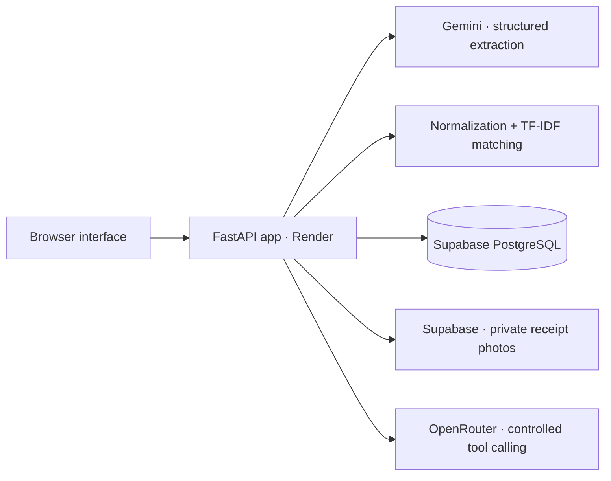

# BobaOps AI

**From Vietnamese sales-report photos to structured sales, auditable inventory and a grounded AI assistant.**

BobaOps is a deployed personal project inspired by my mom’s beverage shop. I built it to connect a messy, manual business workflow with data engineering, applied NLP, relational database design and backend development.

[Live application](https://bobaops.onrender.com) · [Engineering tests](tests) · [Local setup](deploy/local-development.md) · [Deployment guide](deploy/README.md)

*The live app requires private login. Free hosting may take a moment to wake up.*

## The problem

A daily sales report tells the shop how many drinks were sold, but estimating remaining stock requires another step: connecting each drink to its recipe and converting prepared ingredients back into raw materials. A photo of that report also introduces extraction errors, inconsistent names and incomplete rows.

I wanted to build the entire path from that image to useful operational data, with a way for a person to review uncertain results and correct mistakes. The challenge was making the data reliable enough to update inventory, rather than stopping at a successful AI extraction.

## What I built

**Upload → Extract → Match → Review → Approve → Analyze**

- **Sales ingestion:** Gemini extracts dates, product names and quantities from Vietnamese report photos. Multiple photos can form one daily report.
- **Catalog matching:** text normalization and aliases handle known variations; character TF-IDF and cosine similarity suggest matches for imperfect names. Uncertain rows remain available for human review.
- **Inventory accounting:** approved quantities consume ingredients through product recipes and preparation yields. Purchases, physical counts, waste and reversals form a stock-movement history.
- **Analytics:** a dashboard shows approved sales trends, estimated revenue, product rankings, ingredient usage and low-stock indicators.
- **Grounded assistant:** Vietnamese questions are answered using controlled backend tools that retrieve current shop data. The assistant cannot modify stock or execute arbitrary SQL.
- **Editable shop configuration:** products, prices, ingredients, recipes and preparation yields can change through the app, with versions retained for historical calculations.

## Architecture



The frontend and API run in one Docker service. PostgreSQL stores the operational records and inventory ledger; private object storage preserves photos across app restarts. Python and SQL calculate the figures used by the dashboard and assistant.

## Engineering decisions

### Keep AI output separate from inventory updates

An extracted row is a draft, not an instruction to deduct stock. Structured-output validation, product matching and human review precede approval. A preview shows the proposed consumption, and stale previews are rejected when the underlying data changes.

This separation lets the model help interpret the image while database rules govern the sales and inventory records.

### Use lightweight NLP for imperfect product names

Receipt names can include irrelevant suffixes, spelling differences or size labels. I combined deterministic preprocessing with character TF-IDF/cosine similarity instead of making another model request for every match. Size and variant rules constrain the matching, and ambiguous results are presented as suggestions.

The matching runs locally, is inspectable, and adds no external model requests. It still needs evaluation against a labelled receipt dataset before claiming an accuracy score.

### Model stock as a ledger and preserve historical versions

Inventory comes from signed movements rather than repeatedly overwriting one balance. Approval records the applicable recipe, preparation-yield and price versions, so later catalog edits do not rewrite historical consumption.

Sales approval and its deductions commit in one database transaction. Duplicate-image checks, report locks and retry safeguards address repeated uploads and concurrent requests. Reversing an approved report restores its recorded deductions and retains the original report in history.

### Translate preparation recipes into raw-material usage

A drink may consume prepared tea or milk tea, while the shop purchases leaves and powder. The calculation follows the recipe through its preparation yield and keeps grams, millilitres and packaging units distinct.

For example, with **synthetic quantities**:

```text
3 drinks × 160 ml prepared base per drink × (500 g powder / 2,000 ml batch yield)
= 120 g raw powder consumed
```

Ice cream required a different approach: unsold prepared batches are discarded, so sales alone underestimate powder usage. The app records actual daily powder usage separately, while physical counts correct differences between standard recipes and real preparation.

### Ground the assistant in backend calculations

The assistant reads sales, stock and recipes through predefined tools. Numeric calculations stay in Python/SQL; the model explains the returned data. Responses include source figures, and each question is limited to at most two model requests.

### Deploy with persistent data and private access

The app uses Argon2id password hashing, expiring PostgreSQL-backed sessions, logout revocation and CSRF protection. Receipt photos pass through authenticated backend endpoints; storage secret keys are never sent to the browser.

Docker packages the runtime, Alembic manages schema changes, and GitHub Actions runs tests and builds the image. Moving photos from local disk to Supabase Storage allows them to survive Render restarts.

## Technical skills developed

| Area | Practical experience from this project |
| --- | --- |
| Data engineering | Ingesting unstructured images, validating structured records, normalizing names and building a reviewed ingestion workflow |
| Database design | Relational modeling, constraints, migrations, versioned recipes and prices, inventory ledgers and transactional updates |
| Applied NLP | Character TF-IDF, cosine similarity, domain-specific preprocessing and handling ambiguous matches |
| Backend engineering | FastAPI endpoints, Pydantic validation, concurrency controls, retry safety and external API integration |
| Analytics and AI | SQL aggregation, Chart.js dashboards, tool calling and separating model explanations from deterministic calculations |
| Security and deployment | Password hashing, sessions, CSRF, private object storage, Docker, CI and cloud configuration |
| Requirements analysis | Turning shop practices into explicit rules, identifying exceptions and revising assumptions after feedback |

## Verification

The project includes **188 automated tests**, covering validation and calculations as well as integration scenarios against isolated PostgreSQL schemas. Cases include:

- A receipt moving through extraction, matching, approval, inventory deduction, dashboard reporting and reversal.
- Duplicate uploads, repeated approval attempts, concurrent requests and stale edits.
- Transaction rollback, physical stock corrections and recipe-version preservation.
- Private photo access, failed-upload cleanup and photos shared by original reports and correction drafts.
- Login, session expiry, logout revocation, CSRF checks and cloud data-copy safeguards.

AI and storage responses are mocked in the automated suite. Separate Docker checks verified data and photo persistence after container recreation and database backup restoration. See [the tests](tests) and [verification instructions](deploy/local-development.md#tests).

## Stack

**Python 3.14 · FastAPI · Pydantic · PostgreSQL · SQLAlchemy · Alembic · scikit-learn · Gemini · OpenRouter · HTML/CSS/JavaScript · Chart.js · Docker · GitHub Actions · Render · Supabase**

## Scope and next improvements

This is a personal project informed by a real shop workflow, not a claim of measured business adoption or time savings. Some purchase and stock values are synthetic. Revenue is estimated from saved catalog prices; discounts and profit are not calculated.

Next priorities are a labelled benchmark for extraction and matching, and a public walkthrough with synthetic data so reviewers can explore the workflow without private credentials. Shop records, recipe quantities, secrets and receipt photos remain outside the public repository.
